**SISTEMAS DE INFORMACIÓN**  
**SISTEMAS DE INFORMACIÓN PARA LA GESTIÓN**  
   
   
**TRABAJO DE CAMPO INTERDISCIPLINARIO**  
   
**PoliCampo: Sistema de Información Web para la Optimización del Diseño Agroecológico y la Incorporación de Bandas Florales en Terrenos Agrícolas de Jujuy"**   
   
   
**Equipo**  
 

| Integrante | Carrera |
| :--- | :--- |
| Integrante 1 | Licenciatura en Sistemas |
| Integrante 2 | Ingeniería Industrial |
| Integrante 3 | Ingeniería Informática |
| Integrante 4 | Ingeniería Industrial |
| Integrante 5 | Ingeniería Informática |
| Integrante 6 | Ingeniería Informática |
| Integrante 7 | Ingeniería Informática |
| Integrante 8 | Ingeniería Industrial |

**Docentes de la cátedra**  
**Prof. Adjunta: Docente 1**  
**JTP: Docente 2**  
   
**Estudiantes adscriptos a la cátedra**  
**Carrera Ingeniería Informática: Adscripto/a 1**  
**Carrera Ingeniería Industrial: Adscripto/a 2**  
**Carrera Licenciatura en Sistemas: Adscripto/a 3**  
   
**AÑO 2026**

**PoliCampo: Sistema Web de Soporte a la Toma de Decisiones para el Rediseño Agroecológico**     
   
**Introducción**  
   
En la región del NOA de manera particular en la provincia de Jujuy, la actividad agrícola se desarrolla sobre un territorio caracterizado por una gran heterogeneidad climática y geográfica. En estas zonas predominan esquemas de producción basados en el uso intensivo y continuado de insumos químicos sintéticos (pesticidas, herbicidas y fertilizantes) los cuales provocan la contaminación del suelo y de las fuentes de agua, degradan la fertilidad natural del terreno y eliminan de forma directa a las poblaciones de polinizadores nativos e insectos benéficos, debido a su extrema sensibilidad a estos productos. Además, la destrucción de la fauna útil rompe los mecanismos de autorregulación del agroecosistema, atrapando al productor en un círculo de dependencia económica donde debe destinar gran parte de sus ganancias a la compra constante de insumos o al pago de servicios externos de polinización.  
   
La agroecología propone restaurar la agrobiodiversidad incorporando elementos como franjas florales, refugios de biodiversidad y cultivos de servicio e integrando la vegetación nativa y espontánea. Se ha demostrado que destinar aproximadamente un 20% de la superficie del predio a espacios de conservación y biodiversidad funcional fortalece servicios ecosistémicos clave, tales como el control biológico de plagas y una polinización más eficiente, lo que permite incrementar el rendimiento y la calidad comercial de los frutos mientras se reducen significativamente los costos operativos.  
   
El presente trabajo se desarrolla en el marco de las asignaturas Sistemas de Información para la Gestión (para la carrera de Ingeniería Industrial) y Sistemas de Información (para la carrera de Ingeniería Informática), con el propósito de dar respuesta a esta necesidad mediante el desarrollo de un servicio web que asistirá a los productores en la toma de decisiones y funcionará como una herramienta de apoyo técnico para los profesionales del sector.  
   
**Justificación**

Necesidad de la Solución (Problemática de Información)  
A pesar de los múltiples beneficios que ofrece la agroecología, la transición hacia este modelo se ve dificultada por la falta de información técnica organizada y accesible para los productores y profesionales del sector. En la práctica, no disponer de datos sistematizados sobre qué especies vegetales seleccionar, dónde ubicarlas espacialmente dentro de la finca, en qué momento sembrarlas y cómo gestionar sus calendarios de floración y manejo hace que la planificación resulte compleja. Como consecuencia de esta desinformación, la biodiversidad suele percibirse erróneamente como una pérdida o desperdicio de superficie productiva.  
   
**Oportunidad del Proyecto**  
El desarrollo de este proyecto representa la oportunidad de contar con una herramienta centralizada que concentre y organice la información técnica necesaria para la toma de decisiones consciente y estratégica. El sistema permite pensar el terreno agrícola como un sistema integrado, donde la conservación de la agrobiodiversidad y los cultivos comerciales se complementan funcionalmente en lugar de competir.  
   
**Beneficios para el Productor y el Medio Ambiente**  
La implementación de esta solución aporta un doble beneficio:

* Ambiental: Contribuye a evitar el deterioro de los suelos y la contaminación de las fuentes de agua provocados por el uso intensivo de agroquímicos sintéticos, favoreciendo la presencia de polinizadores e insectos benéficos.  
* Productivo y Económico: Impacta directamente en la economía del productor al promover un mayor rendimiento agrícola, la obtención de frutos de mejor calidad comercial (peso, tamaño y apariencia) y una reducción sustancial en los costos de producción derivados de insumos químicos o servicios externos.

   
**Análisis de Situación desde el Enfoque de Sistemas**

**Análisis E / P / S (Entradas, Procesos y Salidas)**

**1\. Entradas (Inputs / Corriente de Entrada)**  
**·**         **Datos del establecimiento y parcelas**: Registro de la superficie total del predio, delimitación de lotes, ubicación geográfica zona (Valles o Yungas de Jujuy) y la disposición actual del terreno mediante formulario o dibujo de croquis interactivo.  
·         **Datos del cultivo comercial principal**: Especie agrícola que produce en la finca (como tomate, pimiento, palta, durazno, cítricos o frutilla), ciclo productivo y prácticas de manejo vigentes.  
·         **Condiciones ambientales y agroclimáticas:** Variables edáficas (características del suelo), pendientes del terreno, disponibilidad hídrica (riego/precipitaciones) y factores climáticos locales como el período libre de heladas.  
**Retroalimentación**  
**·**         **Catálogo de agrobiodiversidad y flora de servicio**: Información técnica de plantas atractoras y de cobertura (vicia, hinojo, perejil, trigo sarraceno), que incluye sus tiempos de floración, dosis de siembra, disponibilidad local y compatibilidad botánica.  
·         **Datos de seguimiento y retroalimentación**: Respuestas y valoraciones cargadas por productores e ingenieros agrónomos mediante cuestionarios post-cosecha sobre la aplicabilidad y evolución del rediseño en el campo.  
**2\. Procesos (Transformación) validación de datos:**  
   
·         **Registro de datos** : La información predial, ambiental y de los cultivos ingresada por los usuarios en la plataforma web.  
·         **Análisis de la superficie**: Evaluación automatizada de la disposición espacial del terreno y sus condiciones ambientales para detectar déficits de biodiversidad e identificar sectores aptos para intervención (destinando hasta un 20% del predio a espacios de conservación).  
·         **Rediseño espacial**: Diseño de distribución geográfica para ubicar corredores florales, bordes vegetados y refugios de biodiversidad dentro del croquis de la finca.  
·         **Análisis de especies** : Determinación de las especies a cultivar según la información ingresada.  
·         **Planificación temporal de actividades**: Planificación de calendarios automatizados con alertas para coordinar las fechas de siembra de forma sincronizada, temporadas de floración escalonada y momentos de corte o incorporación al suelo.  
·         **Desarrollo del informe:** Procesamiento y compilación del diagnóstico y el esquema de diseño seleccionado para estructurar los documentos de salida.  
·         **Análisis de retroalimentación:** Procesamiento de las encuestas finales para evaluar el impacto en campo y recalibrar periódicamente el motor de reglas del sistema.  
   
**3\. Salidas**  
**·**         **Informe de diagnóstico agroecológico predial**: Resumen del estado inicial de la finca con la identificación de necesidades de biodiversidad y áreas intervenibles.  
·         **Propuesta de rediseño espacial**: Esquema visual interactivo con opciones de zonificación para la ubicación estratégica de bandas florales y corredores biológicos en el predio.  
·         **Recomendaciones personalizadas de plantas de servicio:** Listado de especies florales atractoras compatibles con el cultivo principal, indicando dosis de siembra recomendada, estimación de costos y pautas de manejo agronómico.  
·         **Calendario agronómico de planificación:** Cronograma de tareas con alertas oportunas para la siembra, floración y fechas límite de corte antes de que la vegetación complete su ciclo y se convierta en maleza.  
·         **Informe técnico consolidado descargable**: Documento digital resumen (apto para impresión) que integra el diagnóstico, las especies elegidas y el esquema de rediseño para respaldar la toma de decisiones del productor o asesor.  
·         **Estimación de indicadores de impacto económico y productivo**: Proyección del incremento en el rendimiento (entre un 20% y 30%), mejora en la calidad/calibre del fruto y porcentaje de ahorro en la compra de agroquímicos sintéticos (15%) y servicios externos de polinización.

**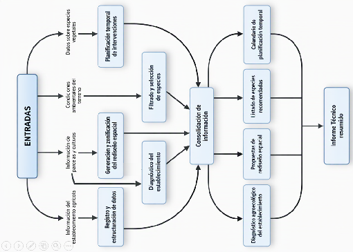**

 **Relación con el ambiente**   
**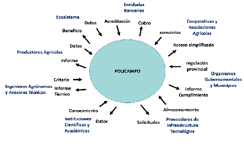**  
**Teoría general de sistemas**  
     **Entropía:** En los sistemas agrícolas convencionales, la entropía se manifiesta como la tendencia natural a la degradación y desorganización del agroecosistema. El monocultivo continuado y el uso de agroquímicos eliminan a los polinizadores nativos, contaminan el suelo y las fuentes de agua, provocando la pérdida de autorregulación del terreno. Asimismo, la falta de datos organizados conduce a decisiones agrícolas improvisadas. Para combatir esta degradación, la agroecología y la sistematización de la información actúan como un elemento de neguentropía (entropía negativa), introduciendo conocimiento, estructura y biodiversidad para restaurar el equilibrio ecológico del predio.

     **Homeostasis:** Representa la capacidad del agroecosistema de autorregularse y mantener un equilibrio dinámico frente a perturbaciones del entorno. Al incorporar franjas florales y refugios de biodiversidad, se fomenta el control biológico natural de plagas y una polinización más eficiente. Esto permite que el sistema agrícola conserve sus niveles de producción y salud ambiental de manera estable, sin depender de intervenciones químicas severas ante cambios ambientales.  
 **Equifinalidad:** Establece que un sistema puede alcanzar un mismo estado final a partir de distintas condiciones iniciales y por diferentes caminos. En el contexto del proyecto, establecimientos agrícolas con diferentes cultivos principales (ej. tomate, pimiento, palta), distintas extensiones o diversas combinaciones de plantas atractoras (vicia, hinojo, trigo sarraceno) pueden alcanzar el mismo objetivo: un terreno rediseñado, ambientalmente sostenible y económicamente rentable mediante los beneficios que las franjas florales le aportan al terreno.

**Multifinalidad**: Apunta a que una misma acción genera múltiples resultados o fines deseados en simultáneo. La incorporación planificada de corredores florales y biodiversidad dentro del terreno logra concurrentemente:  
1\.      Incrementar el rendimiento agrícola y la calidad comercial del fruto.  
2\.      Disminuir los costos de producción por menor uso de fertilizantes y plaguicidas sintéticos.  
3\.      Conservar la biodiversidad de polinizadores e insectos benéficos locales.  
4\.      Generar información organizada para facilitar la toma de decisiones del productor a largo plazo.

**Objetivo General**

Optimizar el diseño de los terrenos de cultivo de frutas y vegetales, mediante el desarrollo de un sistema web que apoye la incorporación de bandas florales por parte de productores e ingenieros agrónomos para alentar la recuperación de la biodiversidad de forma natural en Jujuy, en un plazo de 2 meses.

**Objetivos Específicos**

**Análisis:**

Definir la compatibilidad de plantas de servicio con los cultivos, estaciones, clima y condiciones propias del terreno para brindar la mejor propuesta.  
Establecer los criterios de diagnóstico espacial que permitan estructurar la evaluación de los espacios y condiciones físicas del terreno

**Diseño:**

Establecer los criterios de distribución espacial y temporadas de floración de las plantas de servicio que fundamenten la formulación de propuestas de rediseño del terreno 

**Desarrollo:**

Generar diagnósticos espaciales y recomendaciones de ubicación de corredores florales basadas en reglas agronómicas predefinidas según las características registradas de cada cultivo 

Generar informes con los resultados del diagnóstico y las alternativas de rediseño propuestas para facilitar la evaluación y la toma de decisiones por parte de los productores e ingenieros agrónomos 

**Evaluación:**

Validar las propuestas de rediseño generadas para determinar su factibilidad frente a los requerimientos productivos y de biodiversidad de productores e ingenieros agrónomos 

**Descripción de la Propuesta (Solución)**

Se propone desarrollar un sistema web de apoyo a la toma de decisiones destinado a productores e ingenieros agrónomos de Jujuy, que permita el ingreso de las características y la disposición actual del terreno mediante un croquis o formulario, el cultivo que están produciendo y las condiciones climáticas. A partir de esta información, el sistema ofrecerá un diagnóstico teniendo en cuenta la disposición del terreno y generará la propuesta de rediseño del terreno junto con las plantas de servicio que lo acompañan, dichas recomendaciones estarán basadas en reglas diseñadas y validadas por expertos que sean aplicables en la parcela, brindando mejoras a las condiciones actuales mediante la implementación de franjas florales para obtener beneficios tanto en la biodiversidad del campo agrícola como en la parte económica al reducir la necesidad de agroquímicos como de servicios externos.

**Alcance funcional**  
Registro de los datos de las fincas y los cultivos a través del ingreso directo de los datos mediante la carga por formulario o mediante el dibujo de un croquis del terreno.

Diagnosticar la disposición del terreno y las condiciones ambientales registradas para identificar déficits de biodiversidad y áreas aptas para intervención.

Generar la propuesta de rediseño ofreciendo alternativas de la disposición de los corredores florales dentro del terreno

Recomendar especies de plantas de servicio compatibles según su período de floración, el cultivo comercial principal y las características del terreno.

Planificar un calendario de actividades agroecológicas que permita definir la temporada de siembra, mantenimiento y floración de las bandas incorporadas.

Emitir informes técnicos descargables que consoliden los resultados del diagnóstico, las especies seleccionadas y el esquema de rediseño elegido.

Relevar mediante cuestionarios de seguimiento la valoración de productores e ingenieros agrónomos sobre la aplicabilidad y evolución del rediseño implementado.

**Viabilidad de la Propuesta**

**Viabilidad Operativa**

**Objetivo del análisis**

El presente análisis tiene como objetivo determinar el grado de aceptación que tendría el servicio web propuesto entre sus potenciales usuarios, evaluando su utilidad percibida, predisposición de uso y posible adopción dentro de las actividades habituales de planificación agrícola

**Metodología utilizada**

Para evaluar la viabilidad operativa se realizó una encuesta mediante Google Forms dirigida a productores agrícolas y profesionales vinculados al sector agropecuario. La encuesta fue diseñada con preguntas breves orientadas a conocer el interés de los usuarios potenciales en una herramienta web de apoyo para la planificación agrícola y la toma de decisiones productivas.

**Las personas encuestadas hasta el momento:**

*18 respuestas. La mayoría (66,7 %) son ingenieros/as agrónomos/as; el resto, técnicos agropecuarios, consultores, docentes/investigadores, profesionales ambientales y de ciencias biológicas, y funcionarios de producción.*

**Trabaja o asesora a productores agricolas**

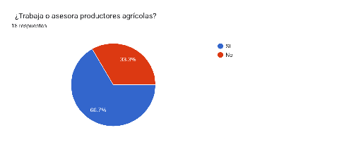

**¿Considera importante incorporar corredores florales o espacios para biodiversidad en los sistemas agrícolas?** 

**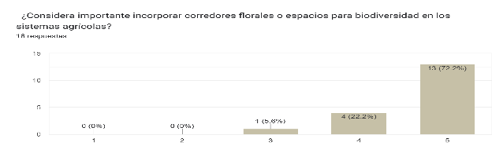**

**Imagine una herramienta web que permita:**

**\*Registrar cultivos y condiciones ambientales.**

**\*Registrar características del terreno.**

**\*Registrar cultivos y condiciones ambientales.**

**\*Obtener propuestas de corredores florales y espacios de biodiversidad.**

**\*Recomendar especies adecuadas para cada zona.**

**\*Generar informes de planificación.**

**¿Considera que esta herramienta sería útil para su trabajo?**

**¿Utilizará una herramienta con estas características?**

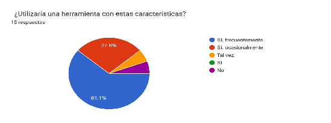 

**¿Cuál de las siguientes funcionalidades considera más importante?** 

**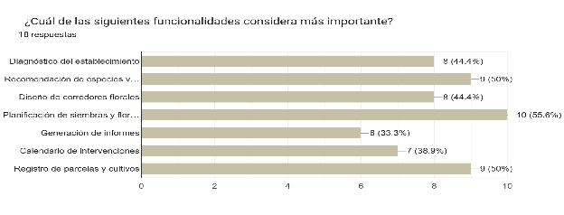**

**En una escala de 1 a 5, ¿qué tan valioso considera este proyecto para el sector agropecuario?** 

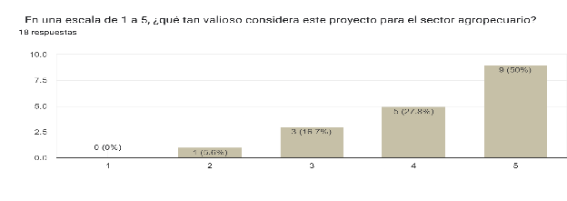

**Conclusión de la viabilidad operativa**

A partir de las respuestas y valoraciones recopiladas a través del *Formulario de Validación*, se concluye que el proyecto PoliCampo es plenamente factible desde el punto de vista operativo.

Los resultados ratifican que:

* Existe una necesidad real y no cubierta en el medio local para encarar la transición agroecológica de forma planificada y confiable.  
* Existe una alta predisposición de uso y aceptación social, ya que la solución no sobrecarga las tareas diarias del productor, sino que simplifica la toma de decisiones, incrementa la rentabilidad por hectárea y reduce la dependencia de insumos químicos o servicios externos.  
* La herramienta resulta totalmente integrable en el flujo de trabajo agrícola, permitiendo tanto la consulta operativa en campo como la emisión de informes estandarizados para asesores agrónomos e instituciones regionales.

  ## **Viabilidad Técnica.**

El análisis de viabilidad técnica determina si es posible diseñar, construir, desplegar y mantener PoliCampo empleando los recursos tecnológicos, la arquitectura de software y las capacidades disponibles dentro del equipo.

El proyecto resulta técnicamente viable, respaldado por los siguientes criterios:

* Arquitectura web y accesibilidad: Al concebirse como una aplicación web responsiva (Sistema de Soporte a la Toma de Decisiones), el acceso se realiza mediante navegador sin depender de instalaciones complejas ni de hardware de alto costo. Esto facilita su uso desde dispositivos habituales de los productores y permite mantener una única base de código centralizada, más sencilla de actualizar y sostener.  
* Lógica de recomendación y base de conocimiento: El sistema se apoya en una estructura organizada de datos agronómicos y reglas lógicas definidas a partir de criterios técnicos (como ubicación, cultivo, suelo, superficie, especies florales, vegetación espontánea y etapas del calendario). Este enfoque permite entregar respuestas coherentes, trazables y adaptadas a cada caso, evitando la complejidad y los posibles errores de modelos abiertos no acotados.  
* Infraestructura y recursos disponibles: Para el desarrollo y la puesta en marcha se aprovecha el equipamiento informático ya disponible de los integrantes, complementado con servicios estándar de alojamiento en la nube y registro de dominio. Esta combinación ofrece estabilidad, respaldo y margen de escalabilidad acordes con el crecimiento progresivo de usuarios y datos.  
* Idoneidad técnica del equipo: El grupo cuenta con los conocimientos necesarios en desarrollo de software, diseño de sistemas, modelado de datos y análisis de procesos para llevar adelante la implementación técnica y el mantenimiento evolutivo de la solución.

**Viabilidad Legal**

Para determinar la viabilidad jurídica del proyecto PoliCarpo, se evalúa la compatibilidad del sistema con la legislación ambiental y agrícola de la provincia de Jujuy, así como con la normativa nacional en materia de tecnologías de la información y protección de datos. El desarrollo e implementación del software no contraviene ninguna reglamentación, ley, decreto ni ordenanza vigente, asegurando su ejecución sin barreras regulatorias.

**Marco Normativo Ambiental y de Sanidad Vegetal (Provincia de Jujuy)**

* Ley Provincial N.º 5063 – Ley General de Medio Ambiente de Jujuy: Establece el marco normativo para la protección, preservación y mejoramiento del ambiente y los recursos naturales en la provincia. PoliCampo se alinea de forma directa con los principios de desarrollo sustentable (Art. 1 y 4), la conservación de la biodiversidad (Art. 12 y 75), la restauración de la flora nativa (Art. 104\) y la protección del hábitat de la fauna silvestre y polinizadores (Art. 112). El sistema no promueve la alteración destructiva del entorno, sino que impulsa la recuperación natural de ecosistemas productivos.  
* Ley Provincial N.º 4975 – Sanidad Vegetal y Agroquímicos de Jujuy: Regula el uso, almacenamiento, comercialización y aplicación de productos fitosanitarios, promoviendo el uso racional de agroquímicos y la adopción de tecnologías menos contaminantes para evitar riesgos en la salud y el ambiente (Art. 1, 2, 9 y 21). La solución propuesta cumple con este marco legal al incentivar la reducción del uso de químicos sintéticos mediante el control biológico de plagas y la atracción de insectos benéficos, brindando recomendaciones agronómicas sostenibles sin contradecir las normativas de sanidad vegetal locales.

**Marco Normativo Informático y de Datos (República Argentina)**

* Ley Nacional N.º 25.326 – Protección de los Datos Personales: Regula el tratamiento integral de la información asentada en archivos, bancos de datos y registros digitales. Debido a que el sistema procesa datos de productores, ingenieros agrónomos, ubicación de fincas y caracterización de parcelas, se garantiza el cumplimiento del principio de confidencialidad, seguridad y consentimiento informado (Art. 5). El software implementa medidas técnicas para resguardar la privacidad e intimidad de los usuarios registrados.  
* Ley Nacional N.º 11.723 – Régimen Legal de la Propiedad Intelectual: Protege los derechos de autor sobre programas de computación (código fuente y código objeto), compilaciones de datos, bases de datos y productos de software (Art. 1). La titularidad de la propiedad intelectual sobre el código del sistema web PoliCampo, la base de datos de especies florales y el motor de reglas de rediseño corresponde al equipo desarrollador (Art. 4), contemplando la emisión de licencias de uso comerciales o institucionales conforme al Art. 55 bis.

**Conclusión de Factibilidad Legal**

El proyecto PoliCampo no presenta restricciones jurídicas para su implantación, respalda el cumplimiento de las normativas ambientales de Jujuy y garantiza el marco de protección de datos y propiedad intelectual exigido por las leyes nacionales de software.   
 

## **Viabilidad Económica (Análisis de Costo Beneficios)**

El Análisis Costo-Beneficio (ACB) tiene como finalidad evaluar la rentabilidad, conveniencia y sostenibilidad financiera de PoliCampo bajo un modelo de servicio tecnológico comercial. Para ello, se contrastan los recursos totales necesarios para desarrollar, lanzar y operar la plataforma frente al impacto económico positivo que esta genera en las explotaciones agrícolas regionales mediante la optimización de la polinización.

Este análisis permite demostrar la viabilidad del proyecto desde una doble perspectiva:

* **Para el productor agrícola (usuario):** Verifica que el retorno económico obtenido por el aumento en el rendimiento y la calidad de sus cultivos, sumado al ahorro en insumos químicos, supera ampliamente el costo de suscripción al servicio digital.  
* **Para el equipo emprendedor (PoliCampo):** Determina el esfuerzo financiero real (desembolsos en efectivo) y el valor económico total de las horas de ingeniería invertidas, estableciendo la base para definir la estructura de precios y el punto de equilibrio del sistema.

### **Modelo de Negocio y Propuesta de Valor** 

**1\. Segmentos de Clientes (Customer Segments)**

* **Usuarios Finales (Beneficiarios de la Solución):**  
  * Pequeños y medianos productores agrícolas de las regiones de Valles y Yungas de Jujuy (focos iniciales en Perico, Monterrico, Palpalá y El Carmen).  
  * Agricultores de cultivos intensivos que requieren o aumentan cuantitativamente su rendimiento/calidad gracias a la polinización (frutilla, arándanos, durazno, tomate, pimiento, palta).  
  * Productores en transición agroecológica que buscan reducir la dependencia de insumos químicos sintéticos dolarizados.  
* **Clientes Institucionales (Compradores / Patrocinadores):**  
  * Organismos públicos y Secretarías de Desarrollo Productivo (Municipios de Perico/Palpalá, Gobierno de la Provincia de Jujuy) orientados a impulsar la sostenibilidad rural.  
  * Cooperativas agrícolas y asociaciones de productores (ej. Cooperativa Los Tatitos).  
  * Instituciones de Ciencia, Técnica y Educación (UNJu, INTA IPAF NOA, CONICET) interesadas en capturar datos de campo a escala mediante ciencia ciudadana para justificar proyectos y becas.

**2\. Propuesta de Valor (Value Propositions)**

* **Para el Productor Agrícola:**  
  * **"La Receta Agroecológica Simple":** Traducción de conocimiento científico complejo en una guía práctica paso a paso en su celular (qué sembrar, qué flora espontánea conservar como hinojo o vicia, y cómo ubicarla en el 20 % del predio).  
  * **Notificaciones y Alertas Oportunas:** Sistema de avisos sobre siembra sincronizada (que el corredor florezca antes que el cultivo principal), riegos y alertas para no pulverizar agroquímicos en horas de vuelo de polinizadores.  
  * **Retorno Económico Tangible:** Incremento del rendimiento (entre 20 % y 60 % según el cultivo), mejora del calibre/simetría del fruto y reducción directa de costos por alquiler de colmenas o pesticidas.  
  * **Información Determinista e Hiperlocal:** Selección de especies ajustada a la disponibilidad real en Jujuy (filtrando lo que hay en el mercado local o flora espontánea sin costo), evitando los errores o "alucinaciones" de IAs generativas genéricas.  
* **Para Investigadores y Organismos (INTA / UNJu):**  
  * **Plataforma de Ciencia Ciudadana / Repositorio de Datos:** Generación del primer historial productivo y banco de datos empíricos sobre el impacto real de franjas florales en fincas locales.

**3\. Canales (Channels)**

* **Canal Digital Directo:** Aplicación Web Responsiva / PWA (Progressive Web App) optimizada para celulares de gama media y adaptable a baja señal rural.  
* **Canales Institucionales y de Extensión:** Talleres presenciales y jornadas de capacitación técnica organizadas en conjunto con las agencias de extensión de INTA (Perico/San Pedro) y cátedras de la Facultad de Ciencias Agrarias (FCA-UNJu).  
* **Difusión Boca a Boca y Cooperativas:** Demostración en parcelas piloto/caso de éxito de productores referentes locales.

**4\. Relación con los Clientes (Customer Relationships)**

* **Automatizada e Interactiva:** Notificaciones push/alertas periódicas en el celular según el calendario agronómico del lote.  
* **Baja Carga Cognitiva:** Interacción ágil mediante fichas visuales breves e intuitivas.  
* **Educativa y Colaborativa (Cierre de Ciclo):** Formulario/encuesta final de cosecha rápida (3 o 4 preguntas visuales) que involucra al productor en la validación empírica y recalibración de las recomendaciones.

**5\. Fuentes de Ingresos (Revenue Streams)**

* **Modelo Tripartito de Sostenibilidad:**  
  1. **Capital Semilla y Subsidios de Investigación (Etapa Inicial):** Fondos públicos provenientes de programas de extensión universitaria (UNJu), proyectos PFI (COFECyT / MinCyT), PICT (Agencia I+D+i / CONICET) y secretarías provinciales.  
  2. **Servicios B2B / B2G (Modelo Comercial y Convenios):** Acuerdos de licencias de uso colectivas con cooperativas agrícolas o contrataciones de municipios/gobierno provincial para subsidiar el acceso a sus productores.  
  3. **Venta de Datos Especializados y Consultoría:** Elaboración de informes técnicos avanzados y analítica de tendencias regionales para empresas o medianos/grandes establecimientos productivos.

**6\. Recursos Claves (Key Resources)**

* **Capital Intelectual y de Conocimiento:** Base de datos relacional agronómica curada con la matriz de relaciones (Cultivo $\rightarrow$ Polinizador $\rightarrow$ Planta Atractora) y el motor de reglas lógicas determinista ("If-Then").  
* **Recursos Humanos (Equipo Multidisciplinario):**  
  * Desarrolladores informáticos para la arquitectura de software, base de datos PostgreSQL, backend en Python e interfaz web.  
  * Ingenieros industriales para la ingeniería de procesos, análisis de costos/factibilidad y gestión de convenios.  
  * Asesores y especialistas externos en agronomía, ecología y zoología agrícola (INTA/FCA-UNJu).  
* **Infraestructura Tecnológica:** Computadoras del equipo (aporte en especie), entorno Cloud (servidor VPS, base de datos cloud y dominio .com.ar).

**7\. Actividades Claves (Key Activities)**

* **Desarrollo y Mantenimiento de Software:** Programación de la PWA, mantenimiento del servidor en la nube y actualización del motor de notificaciones.  
* **Curaduría y Actualización Agroecológica:** Carga y validación continua en el Backoffice de nuevos datos técnicos, floras atractoras y calendarios de siembra a cargo de especialistas (evitando obsolescencia del conocimiento).  
* **Análisis de Datos y Recalibración:** Procesamiento de las encuestas finales de producción cargadas por los productores para alimentar y ajustar las reglas del sistema (lazo de retroalimentación).  
* **Gestión de Vinculación y Relevamiento en Campo:** Visitas a fincas, entrevistas de validación y articulación con referentes institucionales.

**8\. Socios Claves (Key Partners)**

* **Instituciones Académicas y Científicas:** Cátedras de Zoología Agrícola y Ecología de la Facultad de Ciencias Agrarias (UNJu), INTA IPAF NOA y laboratorios del CONICET/INECOA.  
* **Entidades del Sector Agrícola:** Cooperativa Los Tatitos, Cooperativa Apícola Mieles de San Pedro y asociaciones de productores frutihortícolas de Perico y Palpalá.  
* **Organismos Gubernamentales de Financiamiento:** Agencia de Ciencia, Tecnología e Innovación de Jujuy, Ministerios de Producción y COFECyT.  
* **Proveedores de Infraestructura Tecnológica:** Proveedores de hosting cloud (ej. DonWeb, Inovanex) y NIC Argentina para el registro del dominio.

**9\. Estructura de Costos (Cost Structure)**

* **CAPEX Inicial Total (\$5.882.000 ARS):** \$82.000 ARS en desembolsos monetarios directos (Dominio .com.ar, movilidad/viáticos por \$40.000 e insumos de oficina/papelería por \$15.000) \+ \$5.180.000 ARS en aportes profesionales de ingeniería (horas de desarrollo del equipo de 8 valorizadas según el Colegio de Ingenieros de Jujuy).  
* **OPEX Anual Total (\$998.000 ARS):** \$158.500 ARS en efectivo (Hosting cloud por \$114.000, renovación de dominio por \$8.500 y conectividad operativa por \$36.000) \+ \$840.000 ARS anuales en soporte técnico y gestión directiva.  
* **Costo Total Económico del Proyecto:** \$6.880.500 ARS (\$240.500 ARS en efectivo total y \$6.640.000 ARS en costo de oportunidad profesional).

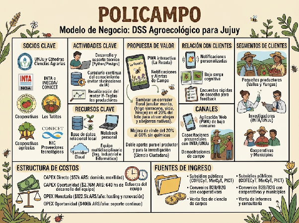

### **Costo total del Proyecto**

Cuadro Resumen Consolidado del CAPEX

| Concepto / Rubro | Naturaleza | Monto Efectivo (ARS) | Valor Económico Total (ARS) | Justificación / Fuente de Referencia |
| ----- | ----- | ----- | ----- | ----- |
| **Dominio Web (.com.ar)** | Monetario Directo | \$27.000 | \$27.000 | Tarifario de registro regional (HostRentable). |
| **Movilidad y Campo** | Monetario Directo | \$40.000 | \$40.000 | Viáticos y traslados al cinturón hortícola local. |
| **Insumos y Oficina (Puesta en Marcha)** | Monetario Directo | \$15.000 | \$15.000 | Papelería para encuestas impresas y material de validación presencial. |
| **Equipamiento Informático** | Aporte en Especie | \$0 | \$0 | Uso de equipos e infraestructura preexistente. |
| **Horas de Desarrollo (Informática)** | Costo de Oportunidad | \$0 | \$4.000.000 | 400 hs en 1 mes (5 int. × 20 hs/sem) a \$10.000/h (Acorde a referencia regional junior del CIJ). |
| **Horas de Ingeniería (Industrial)** | Costo de Oportunidad | \$0 | \$1.800.000 | 240 hs en 1 mes (3 int. × 20 hs/sem) a \$7.500/h (Valoración diferencial de gestión de procesos). |
| **TOTAL CAPEX INICIAL** | **Mixto** | **\$82.000** | **\$5.882.000** | **Puesta en marcha e inversión inicial del proyecto.** |

Cuadro Resumen Consolidado del OPEX (Anual)

| Concepto Operativo | Naturaleza | Monto Efectivo (ARS/año) | Valor Económico Total (ARS/año) | Justificación / Fuente de Referencia |
| ----- | ----- | ----- | ----- | ----- |
| **Alojamiento Cloud (Hosting Web)** | Monetario Fijo | \$114.000 | \$114.000 | Promedio de hosting mes a mes en Argentina (\$9.500/mes). |
| **Renovación Dominio (.com.ar)** | Monetario Fijo | \$8.500 | \$8.500 | Tarifa oficial de renovación anual en NIC Argentina. |
| **Gastos Operativos / Conectividad** | Monetario Fijo | \$36.000 | \$36.000 | Proporcional anual de conectividad y herramientas de gestión virtual. |
| **Soporte Técnico y QA (Informática)** | Costo de Oportunidad | \$0 | \$480.000 | 4 hs/mes de soporte de software y seguridad (\$10.000/h). |
| **Gestión e Ingresos (Industrial)** | Costo de Oportunidad | \$0 | \$360.000 | 4 hs/mes de gestión de convenios y costos (\$7.500/h). |
| **TOTAL OPEX ANUAL** | **Mixto** | **\$158.500** | **\$998.500** | **Costo total de funcionamiento y soporte del sistema.** |

**Resumen de Estructura de Costos (Año 1):**

* **Desembolsos Monetarios Directos (Efectivo):** **\$240.500 ARS** (\$82.000 de inversión inicial \+ \$158.500 anuales de operación y servidores).  
* **Aportes en Especie (Horas de Ingeniería):** **\$6.640.000 ARS** (Valoración profesional de las horas de desarrollo y soporte).  
* **Costo Total del Proyecto Ctotal:** **\$6.880.500 ARS**.

### **Beneficios Tangibles**

Los beneficios tangibles representan aquellas mejoras cuantificables directamente en términos monetarios o físicos derivadas de la implementación de PoliCampo. Para un análisis integral, se desglosan desde la perspectiva del productor agrícola (quien percibe el impacto productivo en finca) y desde la perspectiva del proyecto comercial (ingresos generados por el servicio).

#### **Beneficios Tangibles para el Productor Agrícola (Impacto por Hectárea)**

El núcleo del valor agronómico de la plataforma radica en la optimización de la polinización entomófila mediante el diseño de corredores florales estratégicos distribuidos en el predio.

* **Incremento en el Rendimiento y Calidad Comercial (20% al 30%):** La mayor frecuencia y diversidad de visitas de polinizadores mejora sustancialmente el cuajado, el peso y la simetría de los frutos. Tomando como caso de referencia un cultivo intensivo regional con un rendimiento base de **10.000 kg/ha** y un valor promedio en finca de **\$1.500 ARS/kg**:  
  * *Escenario Conservador (+20% de rinde):* Representa un excedente de 2.000 kg/ha, equivalente a **\$3.000.000 ARS** adicionales por hectárea al año.  
  * *Escenario Optimista (+30% de rinde):* Representa un excedente de 3.000 kg/ha, equivalente a **\$4.500.000 ARS** adicionales por hectárea al año.  
* **Reducción de Costos en Insumos Fitosanitarios (15%):** Los corredores florales no solo atraen polinizadores, sino también enemigos naturales (depredadores y parasitoides) que regulan plagas de forma biológica. Esto permite reducir la aplicación de agroquímicos sintéticos, generando un ahorro operativo estimado en **\$300.000 ARS/ha/año**.  
* **Eliminación de Gastos por Alquiler de Polinización Externa:** Al fomentar poblaciones estables de polinizadores nativos y benéficos propios del entorno, el productor evita el costo logístico y operativo de arrendar colmenas comerciales externas.  
* **Beneficio Económico Neto Generado por Hectárea:** Sumando el incremento de producción y el ahorro en insumos, cada hectárea gestionada bajo las recomendaciones del sistema genera un beneficio tangible de entre **\$3.300.000 y \$4.800.000 ARS anuales**.

### **Beneficios Tangibles para el Proyecto PoliCampo (Flujo de Ingresos Comerciales)**

Bajo el modelo comercial B2B/B2G y de suscripción directa, el sistema captura una fracción marginal del valor generado en finca para asegurar su autosustentabilidad financiera:

* **Ingresos por Suscripciones Individuales y Licencias Colectivas:** Estableciendo un abono anual accesible de **\$204.000 ARS por productor/año** (equivalente a **\$17.000 ARS mensuales**), el proyecto genera ingresos directos escalables.  
* **Proyección de Captación Inicial (Año 1):** Con una meta conservadora de adopción de **50 productores** (articulados a través de cooperativas locales, convenios municipales y suscripciones directas en los Valles y Yungas de Jujuy), el proyecto alcanza una facturación bruta anual de **\$10.200.000 ARS**, logrando cubrir tanto los desembolsos en efectivo (\$240.500 ARS) como el costo de oportunidad profesional del equipo (\$6.640.000 ARS), dejando además un excedente neto positivo.

### **Beneficios Intangibles**

Además de los retornos financieros directos, la implementación de PoliCampo aporta ventajas estratégicas, ambientales y sociales de alto valor que fortalecen la sostenibilidad del proyecto a mediano y largo plazo:

* **Conservación de la Biodiversidad y Resiliencia del Agroecosistema:** La incorporación de franjas florales y el aprovechamiento controlado de la vegetación espontánea restauran hábitats locales, protegen la fauna benéfica nativa y reducen la degradación ambiental de los suelos y cursos de agua por menor carga química.  
* **Democratización y Accesibilidad del Conocimiento Técnico:** Traduce información científica y agronómica compleja en recomendaciones simples, accionables y libres de errores, reduciendo la brecha tecnológica y la incertidumbre de los pequeños productores frente a prácticas agroecológicas.  
* **Generación de Capital de Datos Regionales (Ciencia Ciudadana):** A través de las encuestas post-cosecha, la plataforma consolida el primer historial empírico georreferenciado sobre el impacto de los corredores florales en Jujuy. Este activo de información resulta altamente valioso para instituciones científicas (INTA, UNJu, CONICET) y organismos públicos en el diseño de políticas rurales.  
* **Posicionamiento y Validación Profesional del Equipo:** Para los 8 integrantes del proyecto, el desarrollo y puesta en marcha de una solución real con impacto productivo consolida capacidades interdisciplinarias de gestión, ingeniería de software y formulación de negocios tecnológicos.

### **Demostración de Beneficios sobre Costos (Relación B/C) y Recuperación de la Inversión**

Para ofrecer una evaluación financiera completa y transparente del proyecto PoliCampo, el análisis se presenta bajo una doble perspectiva: la Financiera (Flujo de Caja Efectivo) y la Económica Integral (Incluyendo el Valor de la Ingeniería). Para ello, se toma como base una proyección conservadora de **50 productores suscriptores** en el primer año, bajo un abono profesional de **\$17.000 ARS mensuales** (\$204.000 ARS anuales por usuario).

* **Facturación Bruta Anual Proyectada (Año 1):**  
  Ingresos Totales \= 50 productores x \$204.000ARS/año \= \$10.200.000 ARS\$  
  *(Equivalente a un flujo comercial mensual de **\$850.000 ARS**).*

#### **Perspectiva Financiera: Evaluación sobre Desembolsos en Efectivo**

Evalúa el desempeño del negocio frente al dinero líquido real que el equipo debe desembolsar para lanzar y operar la plataforma (\$82.000 ARS de CAPEX inicial en efectivo \+ \$158.500 ARS de OPEX anual en efectivo).

* **Costo Total en Efectivo**   
  **(${C}_{efectivo}$):** \$240.500 ARS\$

* **Relación Beneficio / Costo (Financiera):**  
  **$Relación\ B/C\ =\ \frac{$\ 10.200.000}{$\ 240.500}=42.41$**

* **Recuperación de la Inversión en Efectivo (Payback):** Con un ingreso mensual de \$850.000 ARS, la inversión inicial en efectivo (\$82.000 ARS) se recupera en apenas 3 días de operación comercial, y la totalidad de los gastos en efectivo del año (\$240.500 ARS) queda cubierta en los primeros 9 días de recaudación.

**Interpretación:** Por cada peso (\$1 ARS) desembolsado en efectivo por el equipo, el sistema genera \$42,41 ARS de ingresos, demostrando un riesgo financiero ínfimo y una liquidez inmediata.

#### **Perspectiva Económica Integral: Evaluación sobre el Costo Total del Proyecto**

Integra en la ecuación el costo de oportunidad profesional de las horas de ingeniería invertidas por los 8 integrantes (tasadas según las escalas de referencia de Córdoba / CPCIPC: \$10.000/h para Informática y \$7.500/h para Industrial), sumando el CAPEX total (\$5.882.000 ARS) y el OPEX total (\$998.500 ARS).

* **Costo Económico Total del Proyecto (${C}_{total}$):** \$6.880.500 ARS\$  
* **Relación Beneficio / Costo (Económica Total):**  
  **$Relación\ B/C\ =\ \frac{$\ 10.200.000}{$\ 6.880.500}=1.48$**

* **Recuperación del Esfuerzo Económico Total (Payback Integral):** Con un flujo mensual de \$850.000 ARS, el proyecto amortiza y recupera la totalidad del valor económico del desarrollo y la gestión en aproximadamente **8 meses** de operación comercial dentro del primer año. Esto deja un excedente neto positivo de **\$3.319.500 ARS** al cierre del ciclo anual, habiendo "pagado" teóricamente todas las horas de trabajo del equipo.

### **Evaluación de Rentabilidad Dinámica: Cálculo de VAN y TIR**

Para complementar el Análisis Costo-Beneficio y evaluar la creación de valor del proyecto PoliCampo a lo largo del tiempo, se proyecta el flujo de fondos neto en un horizonte de 3 años (en moneda constante).

Al igual que en el análisis estático, se presenta la evaluación bajo el Enfoque Económico Integral (incorporando el valor de las horas de ingeniería del equipo de 8 integrantes como inversión inicial y costo operativo), lo que otorga el mayor rigor metodológico posible ante inversores o evaluadores.

#### **Supuestos de Proyección (Horizonte a 3 Años)**

* **Inversión Inicial (${I}_{0}$ \- Año 0):** Corresponde al **CAPEX Total** de puesta en marcha, equivalente a **\$5.882.000 ARS** (\$82.000 ARS en efectivo \+ \$5.800.000 ARS en horas de desarrollo inicial según escalas de Córdoba).  
* **Costos Operativos Anuales (Años 1, 2 y 3):** Corresponde al **OPEX Total Anual** de **\$998.500 ARS** (\$158.500 ARS en efectivo de hosting/conectividad \+ \$840.000 ARS en soporte técnico y gestión).  
* **Proyección de Ingresos Comerciales (Abono de \$204.000 ARS/año por productor):**  
  * **Año 1:** 50 productores activos $\rightarrow$ **\$10.200.000 ARS**  
  * **Año 2:** Crecimiento conservador a 75 productores (+50% por adopción en cooperativas) $\rightarrow$ **\$15.300.000 ARS**  
  * **Año 3:** Consolidación regional con 100 productores $\rightarrow$ **\$20.400.000 ARS**  
* **Tasa de Descuento / Costo de Oportunidad del Capital ($i$):** **15% anual** (tasa real de referencia para proyectos de base tecnológica).

#### **Flujo de Fondos Neto Proyectado ($F{F}_{t}$)**

$FlujodeFondosNeto(F{F}_{t})=IngresosAnuales-OPEXAnual$

| Período | Concepto | Ingresos (ARS) | Egresos / Inversión (ARS) | Flujo de Fondos Neto (ARS) |
| :---- | :---- | :---- | :---- | :---- |
| **Año 0** | Inversión Inicial (CAPEX Total) | \$0 | \-\$5.882.000 | **\-\$5.882.000** |
| **Año 1** | Operación (50 productores) | \$10.200.000 | \-\$998.500 | **\+\$9.201.500** |
| **Año 2** | Operación (75 productores) | \$15.300.000 | \-\$998.500 | **\+\$14.301.500** |
| **Año 3** | Operación (100 productores) | \$20.400.000 | \-\$998.500 | **\+\$19.401.500** |

#### 

#### **Cálculo del Valor Actual Neto (VAN)**

El **VAN** mide cuánto dinero extra genera el proyecto hoy (traído al Año 0), después de haber recuperado toda la inversión inicial (incluyendo las horas de ingeniería) y de haber cubierto la tasa de rentabilidad mínima exigida del 15% anual:

$VAN=-{I}_{0}+\frac{F{F}_{1}}{(1+i{)}^{1}}+\frac{F{F}_{2}}{(1+i{)}^{2}}+\frac{F{F}_{3}}{(1+i{)}^{3}}$

Reemplazando los valores:

$VAN=-5.882.000+\frac{9.201.500}{(1,15{)}^{1}}+\frac{14.301.500}{(1,15{)}^{2}}+\frac{19.401.500}{(1,15{)}^{3}}$

$VAN=-5.882.000+8.001.304+10.813.989+12.756.798$

**VAN= \$25.690.091 ARS\$**

**Explicación e Interpretación del VAN:** Dado que el $VAN>0$ (**\+\$25.690.091 ARS**), el proyecto es altamente rentable y crea valor económico real. Significa que, incluso descontando el valor monetario de las horas trabajadas por los 8 integrantes y exigiendo un rendimiento anual del 15%, el proyecto deja un excedente neto equivalente a más de 25 millones de pesos a valor presente.

#### **Cálculo de la Tasa Interna de Retorno (TIR)**

La **TIR** representa la tasa de rentabilidad porcentual anual que rinde el capital invertido en el proyecto (es la tasa de descuento que hace que el $VAN=0$):

$0=-5.882.000+\frac{9.201.500}{(1+TIR{)}^{1}}+\frac{14.301.500}{(1+TIR{)}^{2}}+\frac{19.401.500}{(1+TIR{)}^{3}}$

Resolviendo la ecuación financiera:

**TIR 174,6%  anual**

**Explicación e Interpretación de la TIR:** La Tasa Interna de Retorno obtenida (174,6%) supera ampliamente la tasa de corte o costo de oportunidad exigida (15%). Esto ocurre porque el desarrollo de software tiene una estructura de costos fijos bajos a partir del segundo año (ya que el desarrollo inicial ocurre una sola vez en el Año 0), permitiendo que cada nuevo productor que se suma incremente casi íntegramente el margen neto del proyecto.

#### **Nota sobre el Escenario Financiero Puro (Solo Efectivo)**

Si se calcularán estos mismos indicadores considerando únicamente los desembolsos reales en efectivo \$82.000 ARS\$ y OPEX efectivo= \$158.500 ARS/año, el VAN financiero ascendería a \+\$33.249.600 ARS y la TIR superaría el 11.000%, confirmando que la barrera de entrada de capital líquido es prácticamente nula frente al potencial de facturación del servicio.

## **Descripción de la Metodología Elegida y Justificación**

**Modelado Estratégico (Business Model Canvas)**

Como herramienta para la formulación inicial y la visualización de la lógica comercial, se implementó la metodología del Business Model Canvas. Su elección se justifica en que permite plasmar de manera sintética y estructurada los nueve pilares fundamentales del emprendimiento —desde la propuesta de valor centrada en los corredores florales hasta los socios clave y canales de distribución—, garantizando la congruencia estratégica antes de avanzar hacia la cuantificación de costos e ingresos.

**Evaluación Financiera (CAPEX, OPEX y Costo de Oportunidad)**

Para el análisis de viabilidad económica, se adoptó un criterio de evaluación basado en el desglose de Inversión Inicial (CAPEX) y Costos Operativos Anuales (OPEX).

* Metodológicamente, se separaron los desembolsos monetarios directos en efectivo (necesarios para cubrir infraestructura cloud, dominio, movilidad y papelería inicial) del costo de oportunidad en especie correspondiente a las horas de ingeniería aportadas por los socios.  
* Dichas horas fueron valoradas de manera profesional utilizando como referencia las escalas arancelarias regionales vigentes del sector tecnológico y del Colegio de Ingenieros, lo que permite evaluar el proyecto tanto desde una perspectiva financiera real de caja (periodo de repago y rentabilidad sobre el capital invertido) como desde una perspectiva económica integral de desarrollo de software.

#### **Evaluación Dinámica de Rentabilidad (VAN y TIR)**

Para superar las limitaciones del análisis estático de un solo año y evaluar la creación de valor del proyecto a mediano plazo, se incorporaron los indicadores financieros dinámicos de Valor Actual Neto (VAN) y Tasa Interna de Retorno (TIR):

* Dado que los proyectos de base tecnológica requieren una fuerte inversión inicial en desarrollo (Año 0\) pero presentan costos operativos marginales muy bajos en los años subsiguientes, el flujo de fondos evoluciona de forma asimétrica en el tiempo. El uso del VAN y la TIR permite actualizar los flujos netos proyectados a un horizonte de 3 años (en moneda constante y bajo una tasa de descuento real del 15% anual), demostrando con rigor matemático que el proyecto no solo recupera la totalidad del esfuerzo de ingeniería invertido, sino que genera valor económico neto sostenible en el tiempo.

   
**Planificación del Proyecto**  
   
Gantt 

* ·         SPRINT 1: Exploración, Relevamiento e Investigación (17/10 al 23/10)  
*  Incremento: Diagnóstico de Necesidades y Base de Conocimiento  
* ·         SPRINT 2: Formulación Estratégica y Definición de Reglas (23/10 al 06/11)  
* Incremento: Formulación del Proyecto y Matriz Costo-Beneficio  
* ·         SPRINT 3: Diseño, Desarrollo del Prototipo y Pruebas (06/11 al 20/11)  
* Incremento: Prototipo Funcional PWA (Diagnóstico, Flora y Calendario)  
* ·         SPRINT 4: Evaluación Final, Informe Técnico y Cierre (20/11 al 02/12)  
* Incremento: Sistema Validado, Informe Consolidado y Exposición

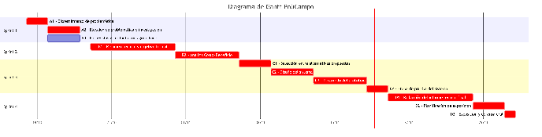

|   | N° | Tarea | Descripción | Fecha Inicio | Fecha Inicio | Encargado(s) |
| ----- | :---- | :---- | ----- | :---- | :---- | :---- |
| **SPRINT 1** | 1 | Discernimiento y selección de problemática | Recopilar información |   |   | Equipo Completo |
|  | 2 | Entrevista con Especialista 1 | Recopilar información |   |   | Integrante 2 |
|  | 3 | Exploración académica y bibliográfica | Recopilar información |   |   | Integrante 2, Integrante 8 |
|  | 4 | Entrevistas de campo con agricultores | Recopilar información |   |   | Integrante 2, Integrante 1 |
|  | 5 | Elaboración del Resumen Técnico | Análisis de lo elaborado |   |   | Equipo Completo |
| **SPRINT 2** | 6 | Redacción formal de Objetivos   | Definición del Objetivo General |   |   | Integrante 1, Integrante 8 |
|  | 7 | Análisis Costo-Beneficio | Viabilidad de costos |   |   | Integrante 1, Integrante 7 |
|  | 8 | Formulario de Viabilidad Operativa | Diseño y distribución de la encuesta |   |   | Integrante 2, Integrante 7 |
| **SPRINT 3** | 9 | Selección entre alternativas propuestas | Elección de la modelo de desarrollo del software |   |   | Integrante 4, Integrante 5 |
|  | 10 | Diseño del sistema | Modelado de Casos de Uso, maquetado de interfaces en Figma y esquema de Base de Datos |   |   | Integrante 3, Integrante 6 |
|  | 11 | Desarrollo del prototipo | Programación de módulos de registro/croquis, diagnóstico, recomendación botánica y calendario |   |   | Integrante 4, Integrante 5 |
|  | 12 | Etapa de prueba del sistema | Pruebas funcionales de usabilidad, validación de reglas con expertos y baja carga cognitiva en móviles |   |   | Integrante 7 |
| **SPRINT 4** | 13 | Redacción del Informe Técnico Final | Consolidación y redacción del documento escrito según la plantilla oficial de la materia |   |   |  (Equipo Completo) |
|  | 14 | Planificación de Exposición | Preparación de diapositivas, estructura gráfica y guion para la defensa del proyecto |   |   | Integrante 3, Integrante 1 |
|  | 15 | Exposición oral y evaluación | Presentación formal del proyecto e informe final ante el tribunal docente de la asignatura |   |   | Equipo Completo |

**Desglose de Iteraciones**

**SPRINT 1: Exploración, Relevamiento e Investigación de Dominio**

* **Período:** 17 de octubre al 23 de octubre (1 semana).  
* **Objetivo:** Discernir la problemática: Agroecología en Jujuy como se desarrolla y de que trata, investigación sobre el tema para poder identificar las necesidades o problemática.  
* **Actividades realizadas:**  
  * Discernimiento y selección de la problemática en la temática seleccionada Agroecología  
  * Entrevista con el profesional Especialista 1 (Ing. Agr.) (investigador del NOA y apicultor) Identificamos el rol de polinizadores, los beneficios al aplicar la regla del 20% de área de conservación.  
  * Visitas de exploración a las cátedras de la Facultad de Ciencias Agrarias (UNJu) y revisión bibliográfica de antecedentes.  
  * Entrevista de campo con el agricultor local: Productor A (Quebrada de Humahuaca), apicultores/mieleros y productores hortícolas.  
* **Entregable funcional (Incremento 1):** Documento de relevamiento de requerimientos del usuario y base de conocimiento técnico inicial.

**SPRINT 2: Formulación Estratégica y Análisis de Viabilidad**

* **Período:** 23 de octubre al 6 de noviembre (2 semanas).  
* **Objetivo:** Estructurar el alcance formal de la solución tecnológica y validar su factibilidad económica y operativa.  
* **Actividades realizadas:**  
  * Elaboración del Resumen Técnico: delimitación del alcance funcional, justificación agronómica, definición del problema y propuesta de solución.  
  * Redacción formal del Objetivo General y Objetivos Específicos.  
  * Desarrollo del Análisis Costo-Beneficio (CAPEX, OPEX, estimación del \+20% a \+30% de incremento en rendimiento y ahorro del 15% en agroquímicos).  
  * Diseño y distribución del *Formulario de Validación de Viabilidad Operativa* a través de Google Forms.  
* **Entregable funcional (Incremento 2):** Documento de formulación de proyecto, matriz costo-beneficio y reporte de viabilidad operativa.

**SPRINT 3: Diseño, Desarrollo del Prototipo y Pruebas del Sistema**

* **Período:** 6 de noviembre al 20 de noviembre (2 semanas).  
* **Objetivo:** Seleccionar la alternativa tecnológica óptima, diseñar la arquitectura web y construir el prototipo funcional de PoliCampo.  
* **Actividades realizadas:**  
  * **Selección entre alternativas propuestas:** Elección de arquitectura PWA (Progressive Web App) determinista basada en reglas lógicas.  
  * **Diseño del sistema:** Modelado de Casos de Uso, maquetado de interfaces de usuario en Figma y diseño del esquema de la base de datos de especies (vicia, hinojo, trigo sarraceno).  
  * **Desarrollo del prototipo:** Programación de módulos de registro predial/croquis, motor de diagnóstico espacial, recomendación botánica y generador de calendarios agronómicos.  
  * **Etapa de prueba del sistema:** Ejecución de pruebas funcionales de usabilidad, validación de reglas con expertos agronómicos y verificación de baja carga cognitiva en celulares.  
* **Entregable funcional (Incremento 3):** Prototipo software interactivo (PWA) probado y funcional para navegación en entorno de demostración.

 

**SPRINT 4: Redacción del Informe Técnico Final y Defensa Oral**

* **Período:** 20 de noviembre al 2 de diciembre (1,5 semanas).  
* **Objetivo:** Consolidar el documento final del trabajo de campo e integrar las observaciones recibidas para la exposición de cierre.  
* **Actividades realizadas:**  
  * Redacción y ensamblado del Informe Técnico Final en cumplimiento con la plantilla oficial (Introducción, TGS, Objetivos, Alcance, Viabilidades, Metodología, Gantt/PERT y Conclusiones).  
  * Planificación y preparación de la presentación gráfica/diapositivas para la defensa institucional.  
  * Exposición oral y evaluación del proyecto ante los docentes de la cátedra.  
* **Entregable funcional (Incremento 4):** Documento final consolidado, sistema listo para entrega e informe de lecciones aprendidas por el equipo interdisciplinario.

Pert 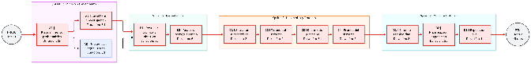  
**Roles y Responsabilidades del Equipo**  
 

| Apellido y Nombre | Responsabilidades | Rol en el Proyecto |
| :---- | :---- | :---- |
| Integrante 1 | Planificación general, coordinación de reuniones y seguimiento de entregables del proyecto. | Líder de Proyecto |
| Integrante 2 | Relevamiento de requisitos agroecológicos y definición de reglas de compatibilidad de plantas de servicio. | Analista de Dominio |
| Integrante 3 | Implementación de la interfaz web, formularios interactivos y el módulo de dibujo del croquis. | Desarrolladora Frontend |
| Integrante 4 | Relevamiento de requisitos agroecológicos y definición de reglas de compatibilidad de plantas de servicio. | Analista de Dominio |
| Integrante 5 | Desarrollo del motor de recomendaciones y lógica de negocio backend del sistema web. | Desarrollador Backend |
| Integrante 6 | Diseño y administración de la base de datos de especies florales, fincas y criterios climáticos. | Administradora de Base de Datos |
| Integrante 7 | Diseño de planes de pruebas, validación funcional de requerimientos y aseguramiento de calidad. | Analista QA / Testing |
| Integrante 8 | Elaboración de la documentación técnica, manuales de usuario y consolidación del informe del proyecto. | Documentador Técnico |

**Desarrollo de la Metodología**  
   
·         Agregar la fase de exploración / relevamiento (toma de conocimiento del tema/lugar/personas involucradas)

Durante esta etapa tuvimos la oportunidad de conocer más sobre la agroecología, los corredores florales y el uso de plantas de servicio en los terrenos agrícolas de Jujuy.

En primer lugar, contactamos a la Ing. Contacto 1, quien nos facilitó el contacto del Especialista 1 (Ing. Agr.), investigador del NOA, apicultor y especialista en agroecología. Él nos brindó su tiempo y participó en tres entrevistas, mediante las cuales pudimos conocer mejor los beneficios de incorporar plantas de servicio y corredores florales en los establecimientos agrícolas. Aprendimos que estas prácticas pueden favorecer la presencia de polinizadores e insectos benéficos, contribuir al cuidado del suelo y ayudar a conservar la biodiversidad, sin dejar de lado la producción.

También establecimos contacto con la Investigadora 1 (Dra. Ing. en Informática), investigadora del CONICET y docente de la Facultad de Ingeniería de la UNJu, quien nos brindó orientación y contactos para continuar con nuestro relevamiento. Gracias a ello, pudimos entrevistar a Productor A, un productor de la Quebrada de Humahuaca, con quien conversamos sobre las prácticas que se utilizan actualmente en el campo y las dificultades que enfrenta.

A partir de la entrevista con Productor A, observamos que existe poco conocimiento sobre los beneficios que pueden aportar los corredores florales y las plantas de servicio. También reconocimos la preocupación por el uso de agroquímicos e insecticidas, ya que su aplicación inadecuada puede afectar la salud de las personas, el suelo, la vegetación y los insectos.

Como complemento de las entrevistas, consultamos el libro *Paisajes agrícolas multifuncionales: De la ciencia a la práctica*, de Lucas A. Garibaldi y otros autores. Esta obra explica que es posible combinar la producción agrícola con la conservación de la naturaleza mediante una mejor distribución de los espacios del terreno. También destaca que los corredores y bordes con vegetación pueden favorecer a los polinizadores y a los insectos que ayudan a controlar las plagas.

Uno de los datos que más nos llamó la atención es que el libro menciona un estudio global que señala la importancia de conservar al menos un 20 % de espacios con vegetación natural dentro de los terrenos agrícolas, para ayudar a conservar la biodiversidad y favorecer la presencia de polinizadores y otros organismos beneficiosos. Este porcentaje sirve como referencia general, ya que la distribución de estos espacios debe adaptarse a las características de cada establecimiento.

A partir de todo lo relevado, como grupo decidimos enfocar nuestro proyecto en el rediseño de terrenos agrícolas y en la recomendación de corredores florales y plantas de servicio, teniendo en cuenta la superficie disponible, los cultivos y las condiciones de cada terreno. Buscamos brindar una herramienta que ayude a productores e ingenieros agrónomos a conocer y aplicar estas alternativas, favoreciendo la biodiversidad y contribuyendo a una producción agrícola más equilibrada.

·         Describir las iteraciones: modelado de la iteración, entregables obtenidos en cada iteración,  y pruebas

| Cu | Descripción  | Actor  |
| :---- | :---- | :---- |
| Registrar Usuario | Para crear una cuenta en el sistema, el usuario efectúa su registro ingresando sus datos personales. | Principal:Usuario  |
| Validar Usuario | El sistema realiza la verificación de la información ingresada por el usuario. | Principal: Usuario |
| Registrar Datos  | El usuario registra información para identificar a sus parcelas y cultivos (hectáreas, tipo de cultivo, región) y condiciones ambientales (el suelo, las pendientes, la disponibilidad de agua, las precipitaciones y otros factores ambientales) | Principal: Usuario |
| Solicitar Diagnóstico | Evaluar la información registrada para identificar condiciones y necesidades relacionadas con la biodiversidad (ej. “no dispusiste el 20% a campos florales”)  | Principal: Usuario |
| Generar propuesta de rediseño | Proporcionará opciones para integrar y distribuir áreas de biodiversidad en el predio, al mismo tiempo que sugerirá plantas de servicio para dichas zonas y la planificación de las tareas correspondientes. | Principal: Usuario |
| Generar informe | El sistema elaborará un informe detallado con las propuestas generadas (seleccionadas por el usuario?), que será posible descargar. Incluye planificación? | Principal: Usuario |
| Pagar Licencia/Suscripción | El Usuario realizará el pago mensual de la licencia por el uso del sistema. | Principal: Usuario Secundario: Entidad Bancaria, Tiempo |
| Generar encuesta | El sistema permitirá realizar encuestas periódicas sobre tareas completadas, avistamientos y resultados de su producción en cantidad y calidad. | Principal: Tiempo |

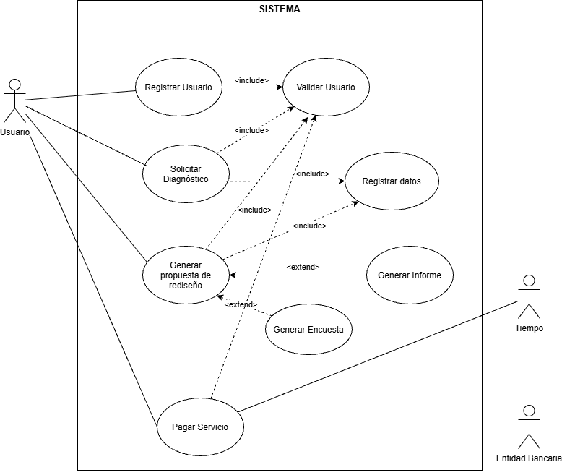

**Diagrama de Colaboración**

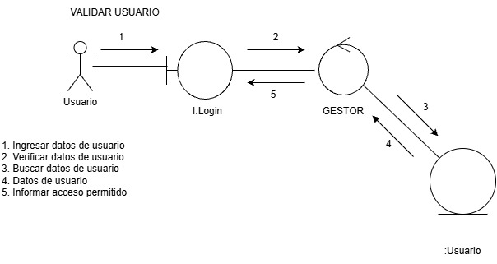  
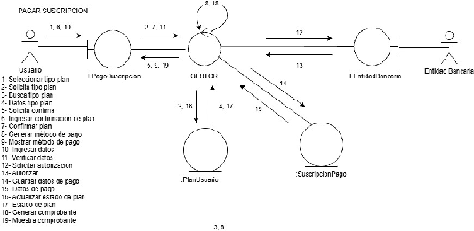  
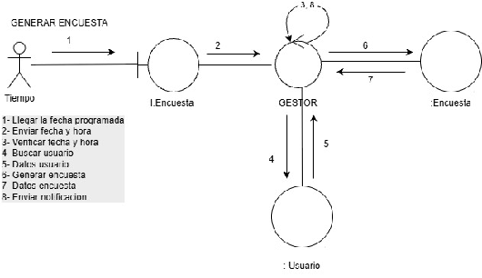

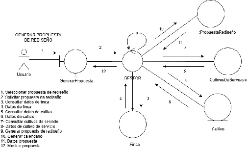  
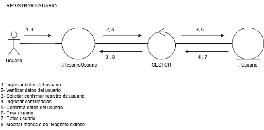

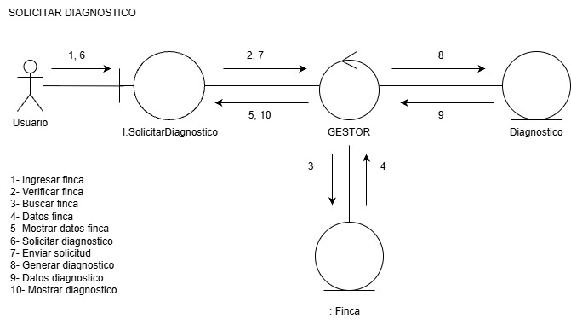

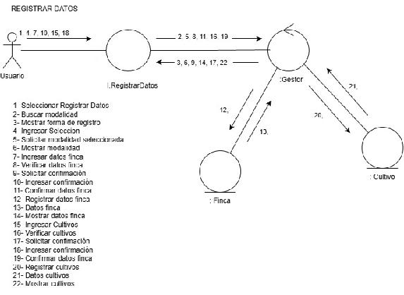  
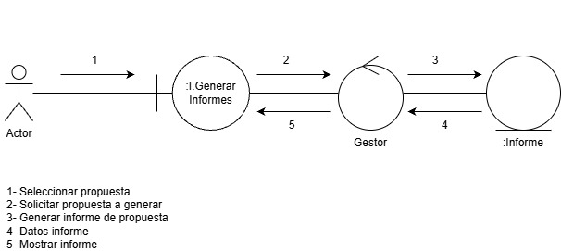

**Diagrama de Secuencia**  
·         Incluir las interfaces de usuario con imágenes  
   
 **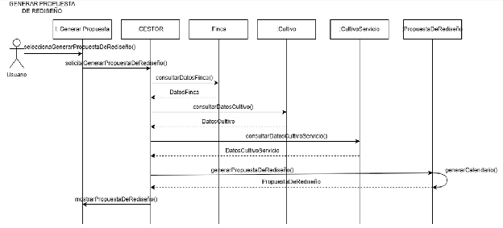**

**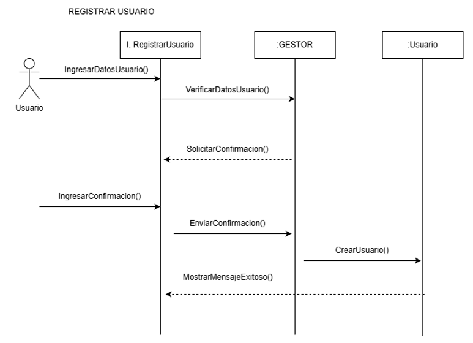**  
**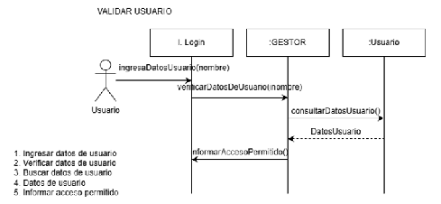**

 **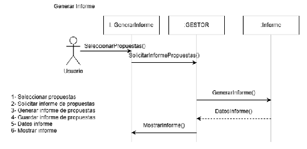**

**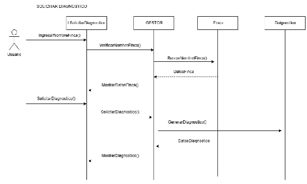**  
**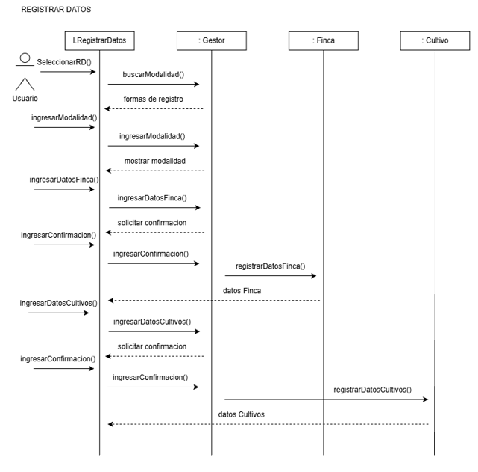**  
**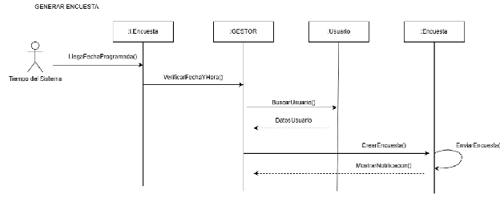**

**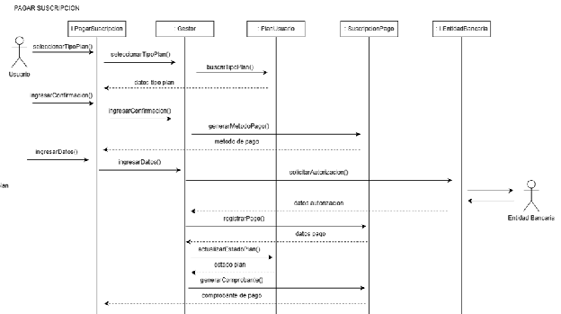**

**Modelo que refleja la solución informática**  
****

****

****  
****  
****

****

****  
****

****

****  
**Conclusiones**  
**Conclusión sobre el Proyecto**  
(Descripción de lo realizado. Se cumplió con el objetivo? lo propuesto se desarrolló en su totalidad? Si no pudo ser desarrollado porque?)  
   
**Conclusión del Equipo sobre la Experiencia del Trabajo de Campo Interdisciplinario**  
Conclusión grupal sobre las experiencias que tuvieron y obtuvieron durante el desarrollo del trabajo.  
   
**Propuesta de Trabajos Futuros**  
¿Qué potencial tiene este trabajo que puede ser desarrollado a futuro?  
   
**Bibliografía**

*Paisajes agrícolas multifuncionales: De la ciencia a la práctica*, de Lucas A. Garibaldi y otros autores.

   
**Anexos**  
Todo lo que consideren que deben incluir en el trabajo: Ej. Entrevistas. Profundizar algún tema con detalles, cuadros, gráficos. 

Profesión"

¿Trabaja o asesora productores agrícolas?"

¿Considera importante incorporar corredores florales o espacios para biodiversidad en los sistemas agrícolas?"

Imagine una herramienta web que permita:

*Registrar cultivos y condiciones ambientales.

*Registrar características del terreno.

*Registrar cultivos y condiciones ambientales.

*Obtener propuestas de corredores florales y espacios de biodiversidad.

*Recomendar especies adecuadas para cada zona.

*Generar informes de planificación.

¿Considera que esta herramienta sería útil para su trabajo?"

¿Utilizaría una herramienta con estas características?"

¿Cuál de las siguientes funcionalidades considera más importante?"

En una escala de 1 a 5, ¿qué tan valioso considera este proyecto para el sector agropecuario?"
