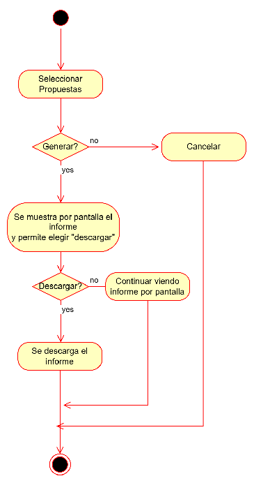

  
**Generar Informe** 

**ID del caso de uso: 006**

**Descripción Textual**

Breve descripción: El sistema permite generar un informe detallado (qué detalles? biodiversidad, sugerencias de plantas de servicios y planificación. pero para lo que ya le gustaron y acepto)

Actores principales: Productor agrícola.

Precondiciones: Debe estar logueado/validado con su cuenta. 

   Haber generado/guardado al menos una sugerencia.

Flujo principal: pasos normales para realizarlo.

|     Actor: Usuario 		 |  Sistema 		 |
| ----- | ----- |
|  1- Seleccionar “Generar Informe de recomendaciones” 		 |  2- Previsualización de todas la recomendaciones generadas 		 |
|  3- Puede seleccionar o quitar las propuestas que desee (dejando al menos una). Y tocar el botòn “Generar” |  4- El sistema generará un informe visible por la página web y también preguntará si desea descargar cómo pdf. 		 		 |
| 5- Selecciona la opción descargar. 		 | 6- El sistema procede con la descarga del informe 		 |

Postcondiciones: qué sucede cuando termina.

Quedaron guardados los datos del informe. Pueden guardarse los informes generados en una tabla (opcional).

El usuario tiene el archivo pdf del informe en su celular o computadora.

Flujos alternativos: errores o situaciones diferentes al camino normal.

7 \- Cancela (2)

8 \- Selecciona no descargar, permanece en la vista por web o también puede regresar al menú principal (4)

**Diagrama de estados**

 

**Diagrama de colaboraciones**

**CU 006**

1. Seleccionar propuestas para el informe  
2. Seleccionar Generar  
3. Verificar Propuestas Seleccionadas  
4. Buscar Propuestas Seleccionadas  
5. Datos Propuestas Seleccionadas (también requiere datos de otras clases)  
6. Visualizar Informe Web  
7. Mostrar opción Descargar Informe PDF  
8. Seleccionar Descargar Informe PDF  
9. Solicitar Generar PDF  
10. Generar PDF  
11. Recibir archivo PDF en Celular/PC  
12. Mostrar mensaje de “Descarga Exitosa”

