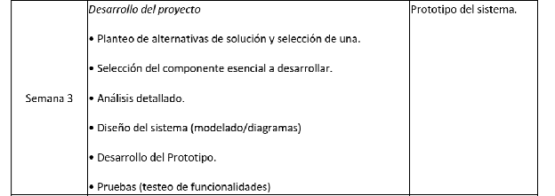

| Alternativa | Descripción | Ventajas | Desventajas |
| ----- | ----- | ----- | ----- |
| A. Aplicación web con motor de reglas | Formularios de carga de terreno y cultivo, base de datos de especies y reglas que generan la propuesta | Accesible desde cualquier dispositivo, fácil de actualizar, viable en pocas semanas | Requiere conectividad; la propuesta espacial es esquemática |
| B. Planilla de cálculo asistida | Plantillas con fórmulas para seleccionar especies y calendarios | Muy simple de implementar, familiar para el usuario | Poco escalable, sin gestión de múltiples establecimientos ni informes automáticos |
| C. Aplicación móvil con mapas (SIG) | Dibujo del terreno sobre un mapa y sugerencia de ubicación de corredores | Mayor valor visual y espacial | Complejidad alta, dependencia de datos geográficos y de conectividad rural |
| D. Sistema experto / recomendador con asesoramiento de agrónomo | Base de conocimiento construida con un especialista | Recomendaciones más confiables | Alta dependencia de la disponibilidad del experto |

E. Plataforma Web Interactiva con Mapa Integrado	  
Sistema web accesible desde el navegador con un módulo tipo Leaflet para dibujar el terreno sobre imágenes satelitales.	  
Accesible desde cualquier PC (ideal para planificación); interfaz visual intuitiva; no requiere instalación.	  
Requiere conexión a internet para cargar el mapa satelital.	 

CU:   
1- Registrar Usuario  
2- Validar Usuario  
3- Registrar parcelas y cultivosEl  
4- Solicitar Diagnóstico  
5- Generar propuesta de rediseño   
6- Generar informe  
7- Pagar Licencia/Suscripción  
8- Generar Encuesta  
*[Fragmento omitido por privacidad: enlace a un archivo interno de Google Drive.]*

| Cu | Descripción  | Actor  |
| :---- | :---- | :---- |
| Registrar Usuario | Para crear una cuenta en el sistema, el usuario efectúa su registro ingresando sus datos personales. | Principal:Usuario  |
| Validar Usuario | El sistema realiza la verificación de la información ingresada por el usuario. | Principal: Usuario |
| Registrar Datos  | El usuario registra información para identificar a sus parcelas y cultivos (hectáreas, tipo de cultivo, región) y condiciones ambientales (el suelo, las pendientes, la disponibilidad de agua, las precipitaciones y otros factores ambientales) | Principal: Usuario |
| Solicitar Diagnóstico | Evaluar la información registrada para identificar condiciones y necesidades relacionadas con la biodiversidad (ej. “no dispusiste el 20% a campos florales”)  | Principal: Usuario |
| Generar propuesta de rediseño | Proporcionará opciones para integrar y distribuir áreas de biodiversidad en el predio, al mismo tiempo que sugerirá plantas de servicio para dichas zonas y la planificación de las tareas correspondientes. | Principal: Usuario |
| Generar informe | El sistema elaborará un informe detallado con las propuestas generadas (seleccionadas por el usuario?), que será posible descargar. Incluye planificación? | Principal: Usuario |
| Pagar Licencia/Suscripción | El Usuario realizará el pago mensual de la licencia por el uso del sistema. | Principal: Usuario Secundario: Entidad Bancaria, Tiempo |
| Generar encuesta | El sistema permitirá realizar encuestas periódicas sobre tareas completadas, avistamientos y resultados de su producción en cantidad y calidad. | Principal: Tiempo |

**Análisis de Casos de Uso**

| N° | CASO DE USO | CLASE ENTIDAD | CLASE INTERFAZ | CLASE CONTROL |
| :---- | :---- | :---- | :---- | :---- |
| 1 | Registrar Usuario | Usuario | I.RegistroUsuario | GESTOR |
| 2 | Validar Usuario | Usuario | I.LoginUsuario | GESTOR |
| 3 | Registrar Datos  | Cultivo Finca | I.RegistrarDatos | GESTOR |
| 4 | Solicitar Diagnóstico | Diagnóstico | I.SolicitarDiagnostico | GESTOR |
| 5 | Generar propuesta de rediseño | Finca Cultivo Propuesta de Rediseño | I.GenerarPropuesta | GESTOR |
| 6 | Generar informe | Informe | I.GenerarInforme | GESTOR |
| 7 | Pagar Licencia/Suscripción | Pago | I.PagoDeServicio I.EntidadBancaria | GESTOR |
| 8 | Generar Encuesta | Encuesta | I.GenerarEncuesta | GESTOR |

| ID Caso de Prueba: 01                                                                         Tipo de Prueba: Unidad CU: Validar usuario |  |  |  |
| ----- | ----- | ----- | ----- |
| Requisito de la prueba: Tiene que existir usuarios registrados Propósito de la prueba: Verificar que usuario esta registrado en la clase “Usuario” |  |  |  |
| Descripción de las acciones y/o condiciones para las pruebas |  |  |  |
| N° | Acciones (entradas) | Salida Esperada | Salida Obtenida |
| 1 | VerficarDatosUsuario() Entrada: nombre de usuario existente | Se ingresa el nombre de usuario en el sistema, se espera que muestre un mensaje “el usuario ya fue registrado” | Muestra en la pantalla el mensaje “el usuario ya fue registrado” |
| 2 | VerficarDatosUsuario() Entrada: nombre de usuario inexistente | Se ingresa el nombre de usuario en el sistema, se espera que muestre un mensaje “Error el usuario no existe, necesita registrarse” | Muestra en la pantalla “el usuario no existe, debe registrarse”. |
| Resultados obtenidos |  |  |  |
| Resultado (Ap/Desap): Aprobado Observaciones: |  |  |  |

| ID Caso de Prueba: 02                                                                       Tipo de Prueba: Unidad CU:  Solicitar Diagnóstico |  |  |  |
| ----- | ----- | ----- | ----- |
| Requisito de la prueba: Tienen que existir fincas registradas Propósito de la prueba: Verificar que existen fincas registradas en la clase Finca |  |  |  |
| Descripción de las acciones y/o condiciones para las pruebas |  |  |  |
| N° | Acciones (entradas) | Salida Esperada | Salida Obtenida |
| 1 | verificarNombreFinca() Entrada: nombre de finca existente | Se ingresa el nombre de una finca en el sistema. Se espera que muestre la finca correspondiente | Se muestra por pantalla la finca correspondiente |
| 2 | verificarNombreFinca() Entrada: nombre de finca no existente | Se ingresa el nombre de una finca inexistente en el sistema. Se espera que se muestre un mensaje “Error: Finca inexistente” | Se muestra por pantalla el mensaje “Error: Finca inexistente”  |
| Resultados obtenidos |  |  |  |
| Resultado (Ap/Desap): Aprobado Observaciones: |  |  |  |

| ID Caso de Prueba: 03                                                                  Tipo de Prueba: Integración  CU: Generar Encuesta |  |  |  |
| ----- | ----- | ----- | ----- |
| Requisito de la prueba: Tienen que existir usuarios y tener encuestas pendientes Propósito de la prueba: Elaborar y enviar al usuario una encuesta de acuerdo a su fecha programada |  |  |  |
| Descripción de las acciones y/o condiciones para las pruebas |  |  |  |
| N° | Acciones (entradas) | Salida Esperada | Salida Obtenida |
| 1 | CrearEncuesta() Entrada: fecha programada y usuario con encuesta pendiente | Es la fecha programada y hay usuario con encuesta pendiente, se espera que el sistema le envie y notifique la encuesta. | Se envía y notifica la encuesta al usuario. |
| 2 | CrearEncuesta() Entrada: fecha programada y usuario no tiene encuesta pendiente | No es la fecha programada y hay usuario con encuesta pendiente, se espera que el sistema espere la fecha correspondiente para enviar y notificar la encuesta. | Se espera la fecha correspondiente para enviar y notificar la encuesta |
| Resultados obtenidos |  |  |  |
| Resultado (Ap/Desap): Aprobado Observaciones: |  |  |  |

| ID Caso de Prueba: 04                                                                  Tipo de Prueba: Integración  CU: Generar Propuesta de Rediseño |  |  |  |
| ----- | ----- | ----- | ----- |
| Requisito de la prueba: Tienen que existir fincas y cultivos, cultivos de servicio Propósito de la prueba: De acuerdo a los datos de las fincas, los cultivos y los cultivos de servicio compatibles se debe generar y mostrar las propuestas de rediseño |  |  |  |
| Descripción de las acciones y/o condiciones para las pruebas |  |  |  |
| N° | Acciones (entradas) | Salida Esperada | Salida Obtenida |
| 1 | generarPropuestaDeRediseño() Entrada: finca existente, cultivo existente y cultivo de servicio compatible | Se solicita generar la propuesta.  Se espera que se consulte la Finca y Cultivo y se genere una propuesta | Se genera una propuesta de rediseño |
| 2 | generarPropuestaDeRediseño() Entrada: finca y cultivo existente y cultivo de servicio incompatible. | Se solicita generar la propuesta.  Se espera que el sistema no genere una propuesta ya que no existe un cultivo compatible y muestra mensaje “No se encontraron cultivos de servicio compatibles” | Se muestra el mensaje “No se encontraron cultivos de servicio compatibles”  |
| Resultados obtenidos |  |  |  |
| Resultado (Ap/Desap): Aprobado Observaciones: |  |  |  |
